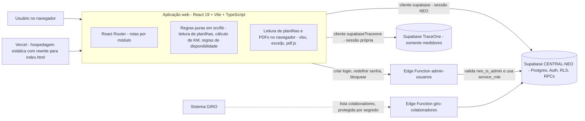

# Diagrama — Arquitetura da Central NEO

Fonte: `CONTEXTO_GERAL.md` §2, `src/lib/supabase.ts`, `src/App.tsx`, `supabase/functions/`. Status: CONFIRMADO (documentação + estrutura do código). O que não aparece aqui não foi verificado.

Legenda: linha tracejada = integração com código presente, uso em produção NÃO VERIFICADO.
