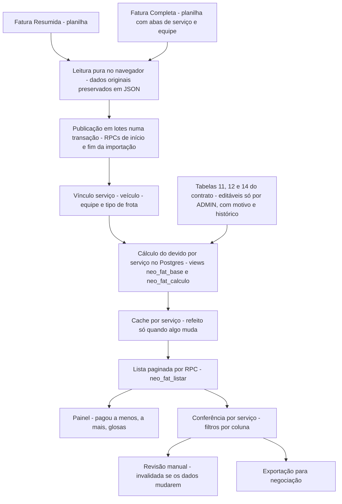

# Diagrama — Conferência de fatura (módulo Faturamento)

Fonte: `CONTEXTO_GERAL.md` §7, `docs/faturamento-relatorio.md`, `src/lib/faturamentoPlanilhas.ts`, `src/lib/faturamento.ts`. Status: CONFIRMADO (documentação consistente com código); resultado financeiro NÃO está representado de propósito.

