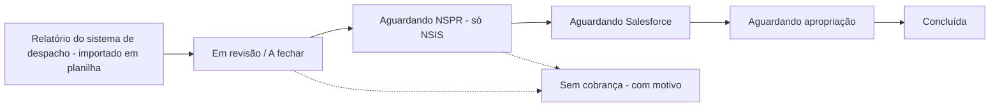

# Diagrama — Etapas do fechamento de notas (módulo Manutenção)

Fonte: `CONTEXTO_GERAL.md` §4 e `src/lib/fechamentoFluxo.ts`. Status: CONFIRMADO (documentação; a view `neo_vw_nsis` calcula a etapa a partir dos itens).

Notas:
- Fluxo novo (NSIS recebidas a partir de 09/11/2026). Serviços do histórico seguem um fluxo anterior: a fechar, aguardando NSMP, NSPR, fatura, faturada.
- A NSRI pula a etapa NSPR: informa NSMC e valor pago logo na primeira etapa.
- Alertas calculados: valor pago diferente do pedido e NSPR sem valor pago.
